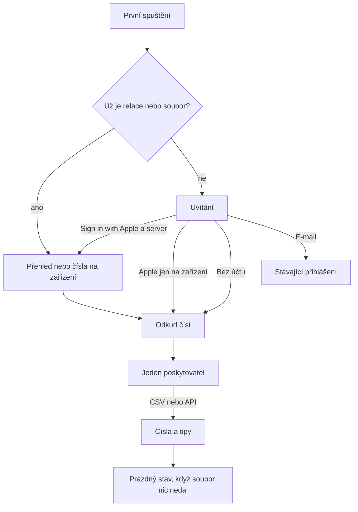

# Tokeny: první spuštění, import a tipy

Návrh pro iOS (App Store `6833010838`) a stejné texty v češtině a angličtině. Web už má první import CSV a serverový sync OpenAI, Anthropicu a OpenRouteru. Nové obrazovky jsou v iOS aplikaci, protože první spuštění, vyzkoušení bez účtu a klíče v Keychainu žijí na zařízení. Na web nepřibyl nový paywall.

Ceník pro odhady je jeden soubor: `apple/TokenyKit/Sources/TokenyCore/Resources/model-prices.json`. Každý řádek má URL zdroje a datum kontroly. Neznámý model nemá cenu, takže tip nesmí dopočítat částku z hlavy.

## Proč která metoda

| Zdroj | Zvolená cesta | Proč |
| --- | --- | --- |
| Grok Bot a Cursor | CSV z Usage (už umíme) a volitelně `GET https://api.cursor.com/v2/teams/billing-items` | Osobní účet nemá veřejné usage API. Týmový Admin API je zdokumentovaný: Basic auth, klíč jako uživatelské jméno, prázdné heslo, scope `read:*` nebo `admin:*`, okno max. 31 dní. E-mail a principal id se neukládají. |
| OpenAI | Admin API `GET /v1/organization/usage/completions` a `GET /v1/organization/costs`, jinak CSV z Usage | Stejné endpointy už volá server. Běžný API klíč usage nečte. Částka jde jen z Costs API (`amount.value` v USD). Když Costs API chybí, řádky mají tokeny a 0 USD, ne odhad z ceníku. |
| Anthropic | Admin API `GET /v1/organizations/usage_report/messages` a `GET /v1/organizations/cost_report` (`anthropic-version: 2023-06-01`), jinak CSV z konzole | Legacy Usage and Cost API Anthropic pořád podporuje a server ho už parsuje. Novější Analytics API v tomhle kroku nevoláme, protože bychom hádali tvar odpovědi. `amount` v cost reportu jsou centy. |
| Gemini | Jen CSV z Google Cloud Billing Reports | AI Studio ani Gemini API klíč nemají usage/cost API. BigQuery export je programová cesta, ale chce GCP oprávnění a není to něco, co má člověk vložit jako klíč. Soubor: filtr Generative Language API nebo Vertex AI, Group by Date a SKU, sloupec Subtotal v USD. Jiná měna se přeskočí. |

Klíč se ukládá jen do Keychainu na zařízení (`cz.martinpohl.tokeny.provider-keys`, po prvním odemčení, jen tohle zařízení). Do Tokeny se neposílá. V UI je maska `sk-ant…abcd`, klíč jde smazat. Text doporučuje klíč jen pro čtení využití.

## Tok

Uvítání se ukáže jen jednou (`tokeny.onboarding.v1`). Kdo už má relaci nebo soubor z dřívější verze, uvítání nevidí. Po zavření uvítání se nevrací.

## Obrazovky

Šířka sloupce je nejvýš 480–560 pt, takže iPhone Air (420 pt) i iPad drží jeden sloupec uprostřed. Jedno vyplněné primární tlačítko. Ostatní akce jsou obrys nebo text. Cíl má aspoň 44 pt. Barvy jsou systémové, světlý i tmavý režim. Částky z importu jsou v USD ze souboru nebo z API. Koruny na zařízení dál používají záložní kurz, dokud účet nenačte ČNB. To je stávající chování a obrazovka to říká.

### 1. Uvítání

Nahoře ikona a nadpis. Jediné vyplněné tlačítko je systémové Sign in with Apple (černé ve světlém režimu, bílé v tmavém). Pod ním obrys „Pokračovat bez účtu“ a text „Použít e-mail“. Google na iPhonu není. Na webu zůstává tam, kde už je, jako druhá volba.

### 2. Odkud číst

Čtyři řádky, žádné vyplněné tlačítko. Vzorek je obrys. „Přihlásit se“ je text, jen když člověk není přihlášený.

### 3. Poskytovatel

Krátký postup. U Cursoru a Gemini je primární „Vybrat CSV“. U OpenAI a Anthropicu je primární „Načíst z API“ a CSV je obrys. Přepnutí schová to druhé vyplněné tlačítko. Pod tím je maska klíče, smazání a poslední import: čas, přidané řádky, duplicity, chyba lidsky.

### 4. Čísla a tipy

Stávající přehled na zařízení. Pod čísly jsou nejvýš čtyři tipy a věta, že jde o odhad. Když soubor nic nedal, zůstane věta „V tomhle souboru nejsou použitelné řádky.“ a cesta zpět na import.

### 5. Prázdný účet

Když přihlášený účet nemá žádnou útratu, jeden blok s jedním tlačítkem „Načíst využití“. Soubor se na účet neodešle.

## Pravidla tipů

Všechny dolary v tipu jsou označené jako odhad. Částka z importu se ceníkem nepřepisuje.

| Tip | Kdy | Odhad |
| --- | --- | --- |
| Levnější model | Alespoň 20 požadavků a průměrná odpověď do 800 tokenů, nebo soubor bez počtu požadavků a aspoň 500 000 tokenů. Model je v ceníku a má tam levnější alternativu. Když je útrata známá, model drží aspoň čtvrtinu. | Útrata krát `(1 − ceník alternativy / ceník modelu)` podle skutečného mixu tokenů. Když soubor nemá dolary, rozdíl ceníkových cen za stejné tokeny a věta, že se porovnávají ceníky. |
| Kešování | Model má cenu cache read. Nejméně 100 000 nekešovaných vstupů a cache read je pod 10 % vstupu. | Polovina nekešovaného vstupu krát rozdíl ceny. První zápis do cache je dražší a v odhadu není. |
| Batch | Ceník má `batchFraction` (Anthropic a Gemini, ověřená polovina). Soubor říká, co je batch, a batch je pod polovinou. | Polovina z té části, která batch není. OpenAI batch v ceníku není, tip se neukáže. |
| Výkyv | Alespoň tři dny s útratou. Nejdražší den je aspoň 2,5× medián ostatních a rozdíl je aspoň 1 USD. | Žádný. Ukazuje se den a částky ze souboru. |
| Strop | Měsíc má útratu a na zařízení není limit. | Žádný. |

Cena Gemini 4 Carbon a Argon v souboru platí do 30. 11. 2026. Po tom datu se řádek nepoužije, místo aby tip počítal se starou zaváděcí cenou. `gpt-5.4-pro` se neshoduje s `gpt-5.4`.

## Texty

České jednopísmenné předložky a spojky mají nezlomitelnou mezeru. V tabulkách je zapsaná jako `·`.

| Klíč (EN) | CS |
| --- | --- |
| See your AI spend | Podívej se na útratu za AI |
| Sign in with Apple, or open a usage file on this iPhone. Real numbers come first. | Přihlas se přes Apple, nebo na tomhle iPhonu otevři soubor s·využitím. Nejdřív uvidíš skutečná čísla. |
| Continue without an account | Pokračovat bez účtu |
| Use e-mail | Použít e-mail |
| Import usage | Načíst využití |
| Where should Tokeny read? | Odkud má Tokeny číst? |
| The file stays on this iPhone. A key stays in the Keychain. Nothing is uploaded. | Soubor zůstane na tomhle iPhonu. Klíč zůstane v·Klíčence. Nic se nikam neodešle. |
| Grok Bot and Cursor | Grok Bot a·Cursor |
| CSV from the dashboard. A team can also use a read-only team key. | CSV z·přehledu. Tým může použít i·klíč jen pro čtení. |
| OpenAI | OpenAI |
| Admin usage key, or a CSV from the usage page. | Admin klíč k·využití, nebo CSV ze stránky Usage. |
| Anthropic | Anthropic |
| Admin usage key, or a CSV from the console. | Admin klíč k·využití, nebo CSV z·konzole. |
| Gemini | Gemini |
| Cloud Billing CSV. Gemini has no usage API for an API key. | CSV z·Cloud Billing. Gemini nemá API využití pro klíč k·API. |
| Open cursor.com/dashboard, then Usage, then Export CSV. The file has Billing Item ID, Event Time and Product. Grok Bot is the product column. A personal account has no usage API. | Otevři cursor.com/dashboard, pak Usage a·Export CSV. Soubor má sloupce Billing Item ID, Event Time a·Product. Grok Bot je ve sloupci Product. Osobní účet nemá API využití. |
| On a team, an admin creates a key at cursor.com/dashboard, API Keys. Use read access. Tokeny stores it in the Keychain and calls api.cursor.com. | V·týmu admin vytvoří klíč na cursor.com/dashboard v·API Keys. Použij přístup jen pro čtení. Tokeny ho uloží do Klíčenky a·volají api.cursor.com. |
| On platform.openai.com open Usage, then Export. Activity data has tokens. Cost data has dollars. Or create an Admin key under Organization settings. A normal API key cannot read usage. Tokeny sends the key only to api.openai.com. | Na platform.openai.com otevři Usage a·pak Export. Activity data mají tokeny. Cost data mají dolary. Nebo vytvoř admin klíč v·nastavení organizace. Běžný klíč k·API využití nepřečte. Tokeny ho posílají jen na api.openai.com. |
| In the Claude console open Usage or Cost and export CSV. Or create an Admin key. A normal API key cannot read the usage report. Tokeny sends the key only to api.anthropic.com. | V·konzoli Claude otevři Usage nebo Cost a·exportuj CSV. Nebo vytvoř admin klíč. Běžný klíč k·API report využití nepřečte. Tokeny ho posílají jen na api.anthropic.com. |
| Google AI Studio has no usage or cost API. In Google Cloud Billing open Reports, filter to Generative Language API or Vertex AI, group by Date and SKU, then Download CSV. Tokeny reads the Subtotal in USD and skips other services. Do not paste a Gemini API key. | Google AI Studio nemá API využití ani nákladů. V·Google Cloud Billing otevři Reports, filtruj na Generative Language API nebo Vertex AI, seskup podle Date a·SKU a·stáhni CSV. Tokeny čte Subtotal v·USD a·ostatní služby přeskočí. Klíč ke Gemini nevkládej. |
| Choose a CSV | Vybrat CSV |
| Load usage | Načíst z·API |
| Use a CSV instead | Místo toho vybrat CSV |
| Use a key instead | Místo toho použít klíč |
| Usage key | Klíč k·využití |
| Saved key | Uložený klíč |
| Delete key | Smazat klíč |
| Last import | Poslední import |
| Rows added | Přidané řádky |
| Already saved | Už uloženo |
| The key could not be saved in the Keychain. | Klíč se nepodařilo uložit do Klíčenky. |
| The key was not accepted. Check that you copied all of it. | Klíč nebyl přijat. Zkontroluj, že jsi ho zkopíroval celý. |
| This key cannot read usage. Create a read-only usage key. | Tenhle klíč využití nepřečte. Vytvoř klíč jen pro čtení využití. |
| The provider is limiting requests. Try again in a minute. | Poskytovatel teď omezuje požadavky. Zkus to za minutu. |
| The provider rejected the request. Check the key type in the steps above. | Poskytovatel požadavek odmítl. Zkontroluj typ klíče v·postupu výše. |
| Tokeny cannot reach the provider right now. A CSV still works offline. | Tokeny se teď k·poskytovateli nedostanou. CSV funguje i·offline. |
| No usable rows in that file. | V·tomhle souboru nejsou použitelné řádky. |
| This file is not a usage export Tokeny can read. | Tenhle soubor není export využití, který Tokeny umí přečíst. |
| Ways to spend less | Jak utrácet méně |
| A cheaper model for repeated work | Levnější model na opakovanou práci |
| Prompt caching | Kešování promptu |
| Batch API | Batch API |
| A day stands out | Jeden den vyčnívá |
| Set a monthly limit | Nastav měsíční strop |
| Estimate | Odhad |
| This is an estimate, not a bill. | Tohle je odhad, ne faktura. |
| %@ to %@. | %1$@ na %2$@. |
| %@ / %@ versus %@ / %@ USD per million tokens. | %1$@ / %2$@ oproti %3$@ / %4$@ USD za milion tokenů. |
| The file has no dollar amount, so this compares list prices. | Soubor nemá částku v·dolarech, takže tohle porovnává ceníkové ceny. |
| Half of the uncached input, priced as a cache read. The first write is not subtracted. | Polovina dosud nekešovaného vstupu, oceněná jako čtení z·cache. První zápis se neodečítá. |
| The list price for batch is half. Rows already marked batch are left out. | Ceníková cena pro batch je poloviční. Řádky označené jako batch se nepočítají. |
| %@ cost %@ against a typical day of %@. | %1$@ stál %2$@, běžný den je %3$@. |
| No monthly limit is set on this iPhone. | Na tomhle iPhonu není měsíční strop. |
| No usage on this account yet | Na tomhle účtu zatím není útrata |
| Import a file on this iPhone. It is not uploaded to your account. | Naimportuj soubor na tomhle iPhonu. Na účet se neodešle. |
| Close | Zavřít |

Zdrojové řetězce jsou v `apple/scripts/gen_xcstrings.py` a v `apple/SharedUI/Localizable.xcstrings`.
